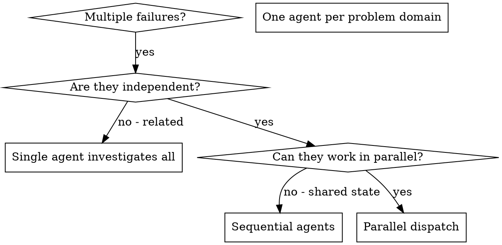

# Dispatching Parallel Agents

Use this workflow for independent investigations. Keep implementation in
the main session by default. For multi-task implementation, use
`subagent-driven-development` when its commit and review workflow fits; delegate
only when the user requests it or independent chunks clearly benefit.

## Overview

You delegate tasks to specialized agents with isolated context. By precisely crafting their instructions and context, you ensure they stay focused and succeed at their task. They should never inherit your session's context or history — you construct exactly what they need. This also preserves your own context for coordination work.

When unrelated failures or subsystems need separate investigation, parallel
read-only analysis can save time. Keep writes and implementation in the main
session unless a separate implementation workflow is justified.

**Core principle:** Dispatch one agent per independent problem domain. Let them work concurrently.

## When to Use



**Use when:**
- Several failures have likely independent causes
- Multiple subsystems need separate exploration
- Each investigation can report findings without changing shared state

**Don't use when:**
- Failures are related (fix one might fix others)
- Need to understand full system state
- Agents would interfere with each other

## The Pattern

### 1. Identify Independent Domains

Group issues by likely independent cause or subsystem.

Each domain is independent - fixing tool approval doesn't affect abort tests.

### 2. Create Focused Agent Tasks

Each investigator gets:
- **Specific scope:** One test file or subsystem
- **Clear goal:** Identify the cause and report evidence
- **Constraints:** Don't change other code
- **Expected output:** Summary of what you found and recommend next

### 3. Dispatch in Parallel

Dispatch one read-only investigator per independent area:

```text
Subagent (explore): "Inspect agent-tool-abort.test.ts failures and report likely cause; do not edit"
Subagent (explore): "Inspect batch-completion-behavior.test.ts failures and report likely cause; do not edit"
Subagent (explore): "Inspect tool-approval-race-conditions.test.ts failures and report likely cause; do not edit"
# All three run concurrently.
```

Use parallel dispatch only when the investigations share no mutable state.

### 4. Reconcile findings

When agents return:
- Read each summary
- Compare conclusions and resolve conflicts
- Implement in the main session, or use a separate implementation workflow when justified
- Run checks required by the user and repository

## Agent Prompt Structure

Good agent prompts are:
1. **Focused** - One clear problem domain
2. **Self-contained** - All context needed to understand the problem
3. **Specific about output** - What should the agent return?

```markdown
Investigate the 3 failing tests in src/agents/agent-tool-abort.test.ts; do not edit:

1. "should abort tool with partial output capture" - expects 'interrupted at' in message
2. "should handle mixed completed and aborted tools" - fast tool aborted instead of completed
3. "should properly track pendingToolCount" - expects 3 results but gets 0

Your task:

1. Read the test file and understand what each test verifies
2. Identify root cause - timing issues or actual bugs?
3. Report the evidence for the likely cause and one useful next check.

Return: Summary of the cause, evidence, and any uncertainty.
```

## Common Mistakes

**❌ Too broad:** "Investigate all failures" - agent gets lost
**✅ Specific:** "Find the likely cause of agent-tool-abort.test.ts failures" - focused scope

**❌ No context:** "Fix the race condition" - agent doesn't know where
**✅ Context:** Paste the error messages and test names

**❌ No constraints:** Agent may edit shared files
**✅ Constraints:** "Read-only; report the cause, do not edit"

**❌ Vague output:** "Fix it" - you don't know what changed
**✅ Specific:** "Return the likely cause, evidence, and a useful next check"

## When NOT to Use

**Related failures:** Fixing one might fix others - investigate together first
**Need full context:** Understanding requires seeing entire system
**Exploratory debugging:** You don't know what's broken yet
**Shared state:** Agents would interfere (editing same files, using same resources)

## Real Example from Session

**Scenario:** 6 test failures across 3 files after a refactor

**Failures:**
- agent-tool-abort.test.ts: 3 failures (timing issues)
- batch-completion-behavior.test.ts: 2 failures (tools not executing)
- tool-approval-race-conditions.test.ts: 1 failure (execution count = 0)

**Decision:** Independent domains - abort logic separate from batch completion separate from race conditions

**Investigations:**
```
Agent 1 → Diagnose agent-tool-abort.test.ts
Agent 2 → Diagnose batch-completion-behavior.test.ts
Agent 3 → Diagnose tool-approval-race-conditions.test.ts
```

**Results:**
- Agent 1: likely event timing issue; cited the relevant wait path
- Agent 2: event structure differs from the consumer's expected shape
- Agent 3: async execution may still be pending when the assertion runs

The main session evaluates these findings, implements appropriate fixes, and
runs the checks required by project guidance.

## Verification

After agents return, compare their evidence, investigate conflicting claims,
and continue in the main session.
