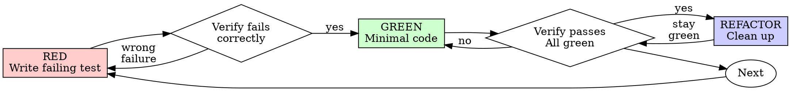

# Test-Driven Development (TDD)

## Overview

When the user or repository instructions call for coverage, write the smallest
test that captures intended behavior, then make the minimal change and run the
relevant checks the project supports. Test-first is useful when the
expected behavior can be stated independently of the implementation.

**Core principle:** If you didn't watch the test fail, you don't know if it tests the right thing.

Follow the user's and repository's testing instructions; this skill does not
require a test for changes with no applicable automated harness.

## When to Use

**Often useful for:**
- New features
- Bug fixes
- Refactoring
- Behavior changes

**Use judgment for:**
- Throwaway prototypes
- Generated code
- Configuration files

If a behavior test is warranted, use the test-first loop where practical.

## The Test-First Loop

```
WHEN A TEST IS REQUIRED, MAKE IT FAIL FOR THE RIGHT REASON BEFORE THE FIX
```

If the implementation already exists, add or update the focused test and
verify the changed behavior instead of discarding useful work to satisfy a
ceremony. Follow the user's and repository's testing instructions; don't run
checks that those instructions prohibit.

## Red-Green-Refactor



### RED - Write Failing Test

Write one minimal test showing what should happen.

<Good>
```typescript
test('retries failed operations 3 times', async () => {
  let attempts = 0;
  const operation = () => {
    attempts++;
    if (attempts < 3) throw new Error('fail');
    return 'success';
  };

  const result = await retryOperation(operation);

  expect(result).toBe('success');
  expect(attempts).toBe(3);
});
```
Clear name, tests real behavior, one thing
</Good>

<Bad>
```typescript
test('retry works', async () => {
  const mock = jest.fn()
    .mockRejectedValueOnce(new Error())
    .mockRejectedValueOnce(new Error())
    .mockResolvedValueOnce('success');
  await retryOperation(mock);
  expect(mock).toHaveBeenCalledTimes(3);
});
```
Vague name, tests mock not code
</Bad>

**Requirements:**
- One behavior
- Clear name
- Real code (no mocks unless unavoidable)

### Verify RED - Watch It Fail

When a focused test is warranted under the user and project instructions,
verify that it fails for the expected reason before implementing.

```bash
npm test path/to/test.test.ts
```

Confirm:
- Test fails (not errors)
- Failure message is expected
- Fails because feature missing (not typos)

**Test passes?** Check whether the behavior already exists; avoid writing
implementation that is not needed.

**Test errors?** Fix error, re-run until it fails correctly.

### GREEN - Minimal Code

Write simplest code to pass the test.

<Good>
```typescript
async function retryOperation<T>(fn: () => Promise<T>): Promise<T> {
  for (let i = 0; i < 3; i++) {
    try {
      return await fn();
    } catch (e) {
      if (i === 2) throw e;
    }
  }
  throw new Error('unreachable');
}
```
Just enough to pass
</Good>

<Bad>
```typescript
async function retryOperation<T>(
  fn: () => Promise<T>,
  options?: {
    maxRetries?: number;
    backoff?: 'linear' | 'exponential';
    onRetry?: (attempt: number) => void;
  }
): Promise<T> {
  // YAGNI
}
```
Over-engineered
</Bad>

Don't add features, refactor other code, or "improve" beyond the test.

### Verify GREEN - Watch It Pass

When the project's test policy calls for running it, verify the focused test
after implementation.

```bash
npm test path/to/test.test.ts
```

Confirm:
- Test passes
- Other tests still pass
- Output pristine (no errors, warnings)

**Test fails?** Fix code, not test.

**Other tests fail?** Fix now.

Run broader checks only when the user's or repository's instructions call for
them. Report the exact scope of what was run; a focused test is not evidence
that the whole suite passes.

### REFACTOR - Clean Up

After green only:
- Remove duplication
- Improve names
- Extract helpers

Keep tests green. Don't add behavior.

### Repeat

Next failing test for next feature.

## Good Tests

| Quality | Good | Bad |
|---------|------|-----|
| **Minimal** | One thing. "and" in name? Split it. | `test('validates email and domain and whitespace')` |
| **Clear** | Name describes behavior | `test('test1')` |
| **Shows intent** | Demonstrates desired API | Obscures what code should do |

For the repository's test conventions, also follow the local `writing-tests`
skill. This directory's
[writing-good-tests.md](writing-good-tests.md) has focused assertion examples:
- Name the production change that would make the test fail — before writing it
- Assert on real behavior, never on mock behavior
- Keep test-only code in test utilities, out of production classes
- Understand a dependency's side effects before mocking it

## Common Rationalizations

| Excuse | Reality |
|--------|---------|
| "Too simple to test" | Simple code breaks. Test takes 30 seconds. |
| "I'll test after" | When test-first is practical, seeing the focused test fail first confirms it detects the missing behavior. |
| "Tests after achieve same goals (spirit not ritual)" | Tests-after answer "what does this do?"; tests-first answer "what should this do?" Tests written after are biased by the code you already wrote — you verify the cases you remembered, not the ones you'd have discovered. Coverage without proof the tests work. |
| "Already manually tested" | Manual testing is ad-hoc: no record of what you covered, no way to re-run it when the code changes, easy to forget cases under pressure. "Worked when I tried it" ≠ comprehensive. Automated tests run the same way every time. |
| "I'll change the assertion to fit the implementation" | Recheck the contract first; implementation behavior may be the bug. |
| "Need to explore first" | Fine. Throw away exploration, start with TDD. |
| "Test hard = design unclear" | Listen to test. Hard to test = hard to use. |
| "TDD will slow me down" | Use test-first when it helps pin expected behavior; for a clear low-risk change, follow the project's normal checks. |
| "Manual test faster" | Manual doesn't prove edge cases. You'll re-test every change. |
| "Existing code has no tests" | You're improving it. Add tests for existing code. |

## Red Flags - Review the test approach

- Code before test
- The test checks implementation details instead of behavior
- Test passes immediately
- Can't explain why test failed
- Tests added "later"
- Rationalizing "just this once"
- "I already manually tested it"
- "Tests after achieve the same purpose"
- "It's about spirit not ritual"
- "This is different because..."

When the project requires a test-first workflow, these are reasons to revisit
the test and implementation. Do not discard useful work just to satisfy a
testing ritual.

## Example: Bug Fix

**Bug:** Empty email accepted

**RED**
```typescript
test('rejects empty email', async () => {
  const result = await submitForm({ email: '' });
  expect(result.error).toBe('Email required');
});
```

**Verify RED**
```bash
$ npm test
FAIL: expected 'Email required', got undefined
```

**GREEN**
```typescript
function submitForm(data: FormData) {
  if (!data.email?.trim()) {
    return { error: 'Email required' };
  }
  // ...
}
```

**Verify GREEN**
```bash
$ npm test
PASS
```

**REFACTOR**
Extract validation for multiple fields if needed.

## Verification Checklist

Before marking work complete:

- [ ] For test-first work, the focused test failed for the expected reason
- [ ] The test covers observable behavior with discriminating assertions
- [ ] Run relevant tests and checks required by project policy
- [ ] Report what ran and any remaining gaps

Use only the checks that apply to the task and the project's test policy.

## When Stuck

| Problem | Solution |
|---------|----------|
| Don't know how to test | Write wished-for API. Write assertion first. Ask your human partner. |
| Test too complicated | Design too complicated. Simplify interface. |
| Must mock everything | Code too coupled. Use dependency injection. |
| Test setup huge | Extract helpers. Still complex? Simplify design. |

## Debugging Integration

When an automated test is appropriate and supported, use it to reproduce the
bug and protect against regression.

## Final Rule

```
Behavior change → use the smallest applicable test when project policy calls for it
Otherwise → follow the user's and repository's instructions
```

This skill does not override project testing policies or user instructions.
